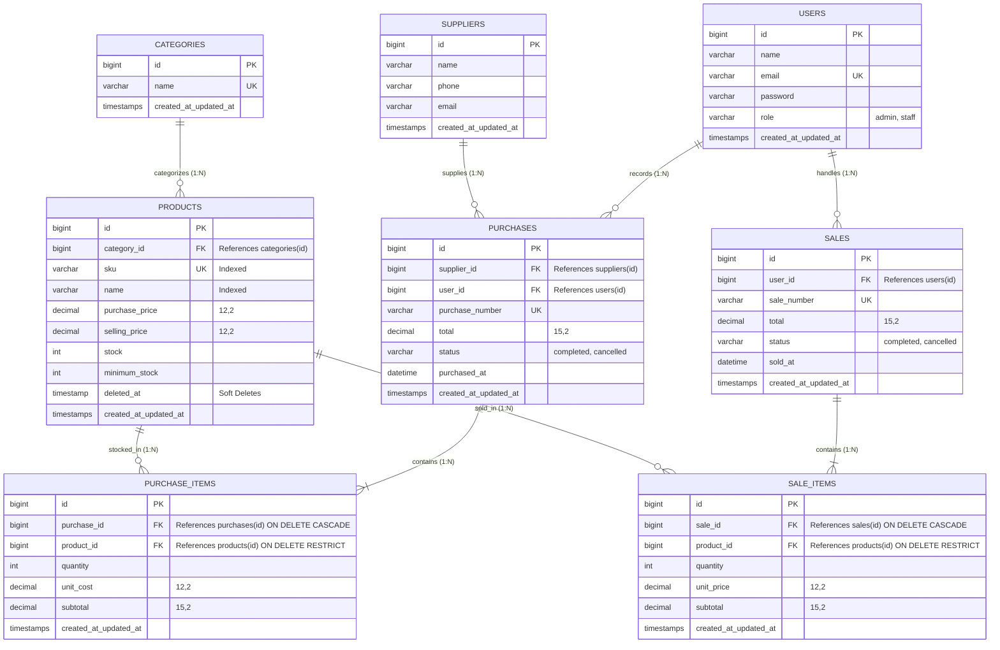

# Integrated Laravel Project - Inventory & Sales Management System

Sistem Informasi Manajemen Persediaan dan Penjualan Barang berbasis Laravel untuk usaha distribusi skala kecil hingga menengah. Aplikasi ini dirancang dengan integritas data tingkat tinggi, arsitektur *clean layered* (Route -> Middleware -> Controller -> Form Request -> Service -> Eloquent -> Blade), pencegahan *overselling* melalui *Pessimistic Locking* (`lockForUpdate`), dan proteksi transaksi menggunakan `DB::transaction`.

---

## 1. Project Overview
Aplikasi ini menyelesaikan permasalahan operasional usaha distribusi, meliputi:
* **Manajemen Stok Real-Time:** Penambahan stok otomatis saat pembelian barang masuk (*Stock-In*) dan pengurangan stok otomatis saat penjualan kasir (*Stock-Out*).
* **Integritas Bisnis:** Pencegahan stok bernilai negatif dan penolakan transaksi jika kuantitas barang tidak mencukupi dengan *rollback* basis data penuh (*Atomicity*).
* **Role-Based Access Control (RBAC):** Pemisahan hak akses antara **Admin/Owner** dan **Staff Operasional** yang ditegakkan di sisi server melalui *Middleware* dan *Gate*.
* **Dashboard Agregat:** Informasi ringkasan metrik inventori dan pendapatan yang dihitung langsung melalui query agregat database, bukan angka statis.
* **Audit Trail & Pembatalan:** Transaksi selesai tidak dapat diedit bebas; pembatalan transaksi oleh Admin memulihkan stok kembali secara konsisten.

---

## 2. Requirements Sistem
* **PHP:** Versi 8.2 atau lebih baru (ekstensi aktif: `pdo_mysql`, `pdo_sqlite`, `bcmath`, `mbstring`, `openssl`).
* **Composer:** Versi 2.x
* **Node.js & NPM:** Node.js v18+ dan NPM v9+
* **Database:** MySQL v8.0+ atau MariaDB (tersedia di XAMPP)
* **Web Server:** Apache (XAMPP) atau Laravel Built-in Server

---

## 3. Panduan Instalasi (Installation)
Ikuti urutan instalasi berikut untuk menjalankan proyek dari repositori baru sesuai instruksi dosen:

```bash
# 1. Clone repositori ke komputer lokal
git clone <url-repo-anda> inventory-uts

# 2. Masuk ke direktori proyek
cd inventory-uts

# 3. Pasang dependensi PHP via Composer
composer install

# 4. Salin file konfigurasi environment
cp .env.example .env

# 5. Generate Application Encryption Key
php artisan key:generate

# 6. Atur koneksi DB di .env dan buat basis data (lihat Bagian 4)

# 7. Jalankan migrasi tabel beserta seeder data awal
php artisan migrate --seed

# 8. Pasang dependensi frontend JavaScript
npm install

# 9. Kompilasi aset Vite untuk produksi
npm run build

# 10. Jalankan web server lokal Laravel
php artisan serve
```

---

## 4. Konfigurasi Environment Setup (.env)
Buka file `.env` dan pastikan konfigurasi koneksi MySQL mengarah ke database `inventory_uts`:
```dotenv
DB_CONNECTION=mysql
DB_HOST=127.0.0.1
DB_PORT=3306
DB_DATABASE=inventory_uts
DB_USERNAME=root
DB_PASSWORD=
```

Pastikan layanan MySQL (XAMPP) sudah aktif, lalu buat basis data `inventory_uts` melalui phpMyAdmin (`http://localhost/phpmyadmin`) atau terminal:
```sql
CREATE DATABASE IF NOT EXISTS inventory_uts;
```

---

## 5. Database Migration & Seeding
Jalankan migrasi tabel beserta *seeder* data awal sesuai panduan:

```bash
php artisan migrate --seed
```

Perintah di atas akan menyiapkan seluruh tabel relasi dan mengisikan data dummy awal yang realistis:
* 3 Akun Demo (1 Admin, 2 Staff)
* 5 Kategori Barang
* 4 Pemasok (Suppliers)
* 12 Produk Lengkap (termasuk produk berstok kritis untuk pengujian dashboard)

---

## 6. Akun Demo (Demo Accounts)

| Peran (Role) | Email Login | Password | Keterangan & Hak Akses |
| :--- | :--- | :--- | :--- |
| **Admin / Owner** | `admin@inventory.com` *(atau `admin@inventory.test`)* | `password` | **Akses Penuh:** Kelola akun & role user, CRUD kategori/produk/supplier, lihat semua transaksi, batalkan transaksi dengan pemulihan stok. |
| **Staff Operasional 1** | `staff@inventory.com` *(atau `staff@inventory.test`)* | `password` | **Akses Kasir/Gudang:** Buat pembelian (stock-in), buat penjualan (stock-out), lihat daftar produk dan stok. Ditolak HTTP 403 jika mengakses fungsi Admin. |
| **Staff Operasional 2** | `staff2@inventory.com` *(atau `staff2@inventory.test`)* | `password` | Akun staf kedua untuk menguji transaksi dari pengguna berbeda. |

---

## 7. Fitur Utama & Hak Akses (Features & RBAC)

| Modul | Fitur | Admin | Staff | Implementasi Keamanan |
| :--- | :--- | :---: | :---: | :--- |
| **Autentikasi** | Login, Logout, Profil | ✅ | ✅ | Laravel Breeze, Bcrypt Password Hashing |
| **User Management** | Tambah, Edit, Hapus, Ubah Role | ✅ | ❌ | `AdminMiddleware`, proteksi hapus akun sendiri |
| **Kategori** | Tambah, Edit, Hapus Kategori | ✅ | ❌ | `CategoryRequest`, proteksi hapus jika ada produk |
| **Pemasok** | Tambah, Edit, Hapus Pemasok | ✅ | ❌ | Proteksi hapus jika memiliki riwayat PO |
| **Produk** | Tambah, Edit, Soft Delete Produk | ✅ | ❌ | `ProductRequest`, SKU unik, `SoftDeletes` |
| **Katalog Produk** | Lihat Daftar, Pencarian, Filter | ✅ | ✅ | `with('category')`, `paginate(10)->withQueryString()` |
| **Pembelian (Stock-In)** | Buat Faktur Multi-Item | ✅ | ✅ | `PurchaseService`, `DB::transaction`, auto-increment stok |
| **Penjualan (Stock-Out)**| Buat Nota Kasir Multi-Item | ✅ | ✅ | `SaleService`, `lockForUpdate()`, tolak jika stok kurang |
| **Pembatalan Transaksi**| Batal Pembelian / Penjualan | ✅ | ❌ | Mengembalikan stok secara konsisten, tolak stok minus |
| **Dashboard** | Metrik Keuangan & Peringatan Stok | ✅ | ✅ | Query agregat `count()` dan `sum()` database riil |
| **Stok Rendah** | Daftar Khusus Stok Kritis | ✅ | ✅ | Query scope `stock <= minimum_stock` |

---

## 8. Cara Menjalankan Aplikasi & Pengujian

### Menjalankan Server Lokal
Jalankan dua perintah berikut pada terminal terpisah:
```bash
# Terminal 1: Build aset frontend Vite
npm run build
# Atau untuk hot-reload saat development: npm run dev

# Terminal 2: Jalankan web server Laravel
php artisan serve
```
Akses aplikasi melalui peramban web pada alamat: **[http://localhost:8000](http://localhost:8000)**.

### Menjalankan Automated Testing
Pengujian otomatis dikonfigurasi menggunakan **SQLite In-Memory** di `phpunit.xml` sehingga **tidak akan menyentuh atau menghapus data riil** di basis data MySQL `inventory_uts`:
```bash
php artisan test
```
Seluruh 51 test case mencakup pengujian otorisasi, validasi SKU unik, integritas stok, rollback transaksi, dan perhitungan agregat.

---

## 9. Entity Relationship Diagram (ERD)



### Penjelasan Relasi Eloquent
1. **Header-Detail Pattern (`purchases` -> `purchase_items` & `sales` -> `sale_items`):**
   - **Kenapa `Sale` hasMany `SaleItem` dan FK ada di tabel detail?**
     Satu nota faktur dapat memuat banyak macam barang. Sesuai kaidah normalisasi relasional (1NF-3NF), data berulang tidak boleh ditaruh pada kolom baris di tabel header `sales`. Foreign key (`sale_id`) ditempatkan pada tabel anak `sale_items` untuk menunjuk ke nota induknya.
   - **Snapshot Harga Transaksi (`unit_price` & `unit_cost`):**
     Harga beli dan jual disimpan di tabel item sebagai riwayat audit permanen. Jika harga master pada tabel `products` diubah di masa depan (akibat inflasi), laporan penjualan masa lalu tetap akurat.
2. **Pencegahan N+1 Query:**
   Seluruh query relasi menggunakan `with()` (misal `Product::with('category')->paginate(10)`), membatasi pemanggilan ke basis data hanya 2 query teroptimasi.

---

## 10. Checklist Definition of Done (DoD)

- [x] **Jalan dari README di Environment Bersih:** Pengujian instalasi dan migrasi berjalan lancar (`composer install`, `npm install`, `migrate --seed`).
- [x] **Login dan Role Berjalan:** Role `admin` dan `staff` diproteksi ketat di server-side via `AdminMiddleware` (HTTP 403 jika staf mencoba akses rute admin).
- [x] **Admin Kelola Master Data:** CRUD Kategori, Produk, Pemasok, dan User berfungsi dengan validasi Form Request.
- [x] **Purchase Menambah Stok:** Pembelian multi-item berhasil menambah stok fisik secara otomatis.
- [x] **Sales Mengurangi Stok:** Penjualan multi-item memotong stok secara otomatis dengan harga resmi database.
- [x] **Proteksi Stok Tidak Cukup:** Permintaan penjualan melebihi stok ditolak dengan pesan spesifik, data di-rollback tanpa perubahan.
- [x] **Integritas Database Transaction & Pessimistic Locking:** `DB::transaction` dan `Product::lockForUpdate()` mencegah *overselling* dan menjamin *Atomicity*.
- [x] **Relasi, Search, Filter, & Pagination:** Filter SKU, nama, kategori, status, dan tanggal bekerja dengan mempertahankan query string (`withQueryString()`).
- [x] **Dashboard Aktual:** Angka total produk, transaksi, dan omzet dihitung via query agregat `count()` dan `sum()` dari basis data riil (hanya transaksi selesai).
- [x] **Keamanan & Kebersihan Repo:** Tidak ada kredensial pribadi; `.env` diabaikan oleh `.gitignore`; `.env.example` bersih; CSRF dan Password Hashing aktif.
- [x] **Persiapan Code Interview:** Dokumentasi lengkap tersedia di [`docs/PENJELASAN_KODE.md`](docs/PENJELASAN_KODE.md).

---

## 11. Known Limitations (Batasan Sistem)
* Sistem belum mengintegrasikan payment gateway pihak ketiga (seperti Midtrans/Xendit) karena menggunakan sistem kasir distribusi tunai/faktur langsung.
* Multi-gudang (*multi-warehouse*) belum diterapkan; seluruh persediaan dihitung dalam satu gudang terpusat.
* Mata uang sistem menggunakan Rupiah (IDR) secara tunggal tanpa konversi kurs multi-currency otomatis.
